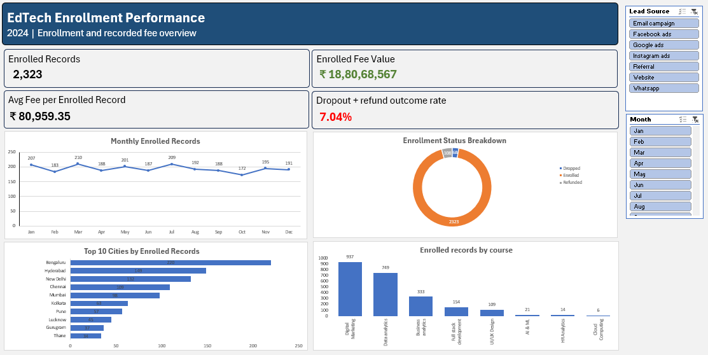
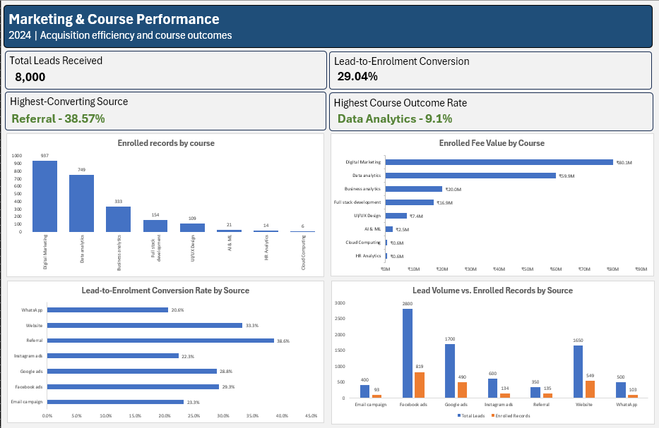
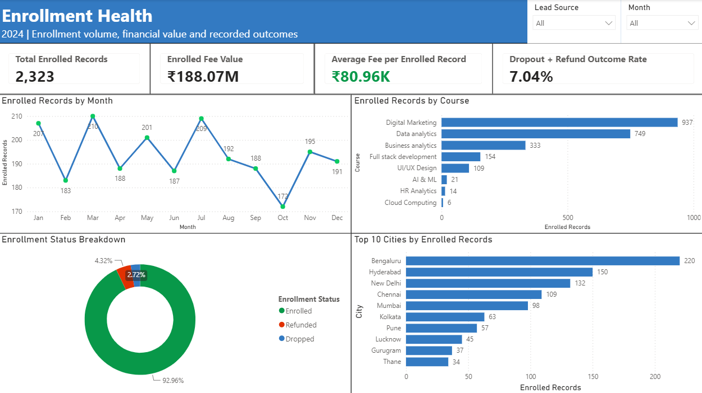
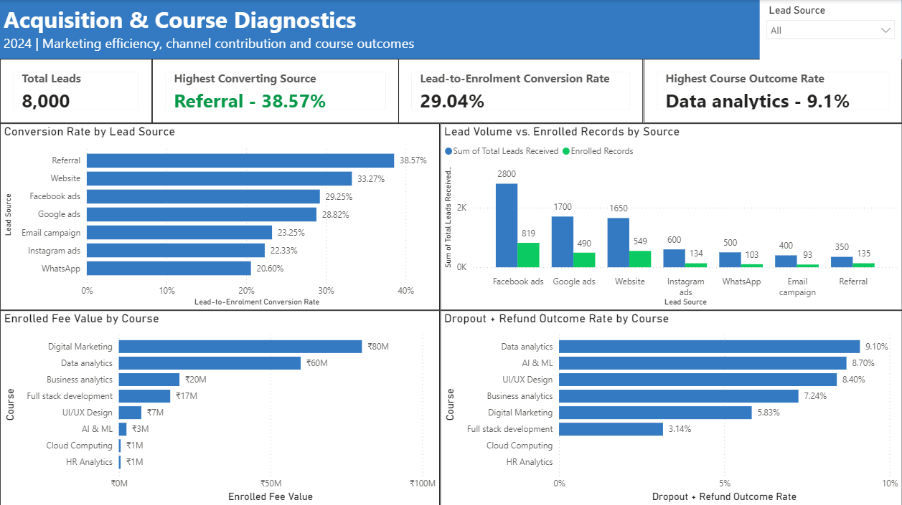

# EdTech Sales Analysis | Enrollment, Course & Lead-Source Performance (2024)

**Business Analysis | SQL (PostgreSQL) | Microsoft Excel | Power BI**

An end-to-end analytics case study examining enrollment health, course demand, recorded fee value, lead-source contribution and learner outcomes using a 2024 EdTech enrollment dataset.

The project combines business requirements documentation, structured SQL analysis, Excel-based reporting and two Power BI dashboards to translate enrollment data into actionable business insights.

---

## 1. Business Objective

Establish a consolidated view of enrollment performance to help management understand:

- Overall enrollment volume and status distribution.
- Course-level enrollment demand and recorded fee value.
- Monthly enrollment patterns and geographic concentration.
- Lead-source contribution under the supplied case-study lead-volume assumptions.
- Differences in dropped and refunded outcomes across courses and lead sources.

The analysis is descriptive and intended to identify performance patterns and investigation priorities, rather than establish causal relationships.

## 2. Dataset & Reporting Baseline

The analysis uses the supplied 2024 enrollment dataset, containing 2,499 records and 13 fields, alongside a separate lead-source input containing seven source categories.

| Business Measure | Result |
|---|---:|
| Enrollment records | 2,499 |
| Enrolled records | 2,323 |
| Dropped records | 68 |
| Refunded records | 108 |
| Enrollment share | 92.96% |
| Dropped + Refunded rate | 7.04% |
| Recorded enrolled fee value | ₹18,80,68,567 |
| Average recorded enrolled fee | ₹80,959.35 |
| Assumed lead volume | 8,000 |
| Lead-source categories | 7 |
| Case-study lead-to-enrolment rate | 29.04% |

**Metric qualification:** Recorded enrolled fee value is calculated by summing the Fees field for records with Enrolled status. It does not establish actual collections, recognised revenue or cash refunds.

The 8,000 lead volumes are assumed case-study inputs, not observed CRM lead records.

## 3. Analytical Framework

The analysis focuses on four areas:

**Enrollment Health**
- Total enrollment records and status distribution.
- Enrolled share and combined dropped/refunded rate.
- Monthly enrolled-record movement.

**Course Performance**
- Enrolled records by course.
- Recorded enrolled fee value by course.
- Dropped and refunded outcomes by course.

**Lead-Source Analysis**
- Assumed lead volume by source.
- Enrolled-record contribution by source.
- Case-study lead-to-enrolment rate using assumed lead inputs.
- Dropped and refunded outcomes by lead source.

**Geographic Performance**
- City-wise enrolled-record distribution.
- Identification of the highest-contribution cities.

## 4. Key Business Findings

### Course Demand & Outcomes

- Digital Marketing and Data Analytics account for 1,819 of 2,499 enrollment records, representing 72.8% of total records.
- Digital Marketing has the highest enrolled-record count at 937, followed by Data Analytics at 749.
- Data Analytics has the highest combined dropped/refunded rate: 75 of 824 records, or 9.10%.

**Business implication:** These two courses represent the largest demand concentration. Data Analytics warrants closer monitoring of its recorded dropped/refunded outcomes.

### Lead-Source Contribution

- Facebook Ads, Website and Google Ads contribute 1,858 of 2,323 enrolled records, representing 80.0% of enrolled records.
- Under the assumed lead-volume scenario, Referral has the highest lead-to-enrolment rate at 38.57%.
- WhatsApp has the lowest scenario rate at 20.60%.
- The overall case-study lead-to-enrolment rate is 29.04%.

**Business implication:** The source comparisons are directional and should be validated against actual CRM lead records before they are used for acquisition-budget decisions.

### Monthly Enrollment

- March records the highest enrolled volume at 210.
- October records the lowest enrolled volume at 172.
- Monthly enrolled-record counts reconcile to 2,323 for the year.

**Business implication:** Monthly movement can be used as a monitoring baseline, with lower-volume periods flagged for further investigation.

### Geographic Contribution

The highest enrolled-record counts are concentrated in:

| City | Enrolled Records |
|---|---:|
| Bengaluru | 220 |
| Hyderabad | 150 |
| New Delhi | 132 |
| Chennai | 109 |
| Mumbai | 98 |

**Business implication:** City-level concentration provides a basis for regional performance monitoring and further market analysis.

## 5. SQL Analysis — PostgreSQL

The SQL script contains nine read-only analytical queries designed to answer the project's core business questions.

| Query Area | Analytical Output |
|---|---|
| Dataset inspection | Ordered preview of enrollment records |
| Enrollment health | Total records, enrolled records, dropped/refunded records, recorded enrolled fee value, average enrolled fee and dropped/refunded rate |
| Monthly trend | Monthly enrolled-record counts using `DATE_TRUNC` |
| Status distribution | Record counts and percentage share by enrollment status |
| Course performance | Enrolled-record counts by course |
| Geographic performance | Top 10 cities by enrolled records |
| Lead-source comparison | Assumed lead volumes, enrolled records and case-study lead-to-enrolment rates |
| Fee-value analysis | Recorded enrolled fee value and enrolled-record counts by course |
| Course outcome diagnostics | Dropped/refunded counts and rates by course |

### SQL Techniques

- Aggregation using `COUNT`, `SUM` and `AVG`.
- Conditional aggregation using PostgreSQL `FILTER`.
- Grouping and sorting using `GROUP BY` and `ORDER BY`.
- Monthly date aggregation using `DATE_TRUNC`.
- Source matching using `LEFT JOIN`, `LOWER` and `TRIM`.
- Safe denominator handling using `NULLIF`.
- Conditional fee-value calculations for Enrolled records.

### Execution Requirements

The script is written for PostgreSQL and expects the following validated staging tables to exist in the `testdb` database:

- `public.edtech_sales_data_import`
- `public.lead_source_inputs_import`

All queries are read-only. The script does not create the staging tables or perform the initial data import.

## 6. Dashboard Deliverables

### Microsoft Excel

The Excel workbook contains the source data, supporting analysis, KPI outputs and two dashboard views.

**Business Overview**

**Marketing & Course Analysis**

### Microsoft Power BI

Two stakeholder-focused dashboards provide complementary views of enrollment health and acquisition/course diagnostics.

**Dashboard 1 — Enrollment Health**

**Dashboard 2 — Acquisition & Course Diagnostics**

The dashboard design separates overall enrollment monitoring from source and course-level diagnostics, while maintaining consistent KPI definitions.

## 7. Business Requirements Document

The accompanying BRD documents:

- Business context, problem statement and project scope.
- Intended stakeholders and analytical workflow.
- KPI definitions and interpretation rules.
- Seven prioritised business requirements.
- Functional requirements for both Power BI dashboards.
- Data-quality checks, business rules and acceptance criteria.
- Assumptions, dependencies, risks and analytical limitations.
- Recommendations and requirement traceability.

[View the EdTech Sales Analysis BRD](<BRD Project summary/EdTech_Sales_Analysis_BRD(1).pdf>)

The document is a portfolio case-study specification. No external stakeholder sign-off or interview evidence was supplied.

## 8. Data Quality & Business Rules

Key validation controls include:

- 2,499 enrollment records with unique, non-null Record IDs.
- No missing values identified across the supplied enrollment records.
- No exact duplicate rows identified.
- Status counts reconcile to 2,323 Enrolled, 68 Dropped and 108 Refunded.
- All seven lead-source categories match after trimming and case normalisation.
- Record ID is the unit of record counting; repeated Enrollment IDs and Student IDs are not automatically treated as erroneous duplicates.

The combined dropped/refunded rate is calculated as:

**(Dropped records + Refunded records) / Total records in the selected group**

The case-study lead-to-enrolment rate is calculated as:

**Enrolled records by source / Assumed lead volume by source**

The latter is a scenario estimate, not a verified CRM conversion rate.

## 9. Limitations & Further Data Requirements

The available data supports descriptive reporting but does not support:

- Verified CAC, ROI, ROAS or marketing-channel profitability.
- Actual lead-funnel progression or source-level attribution.
- Causal explanations for dropout or refund outcomes.
- Verified fee collections or cash-refund calculations.
- Learner retention, completion or post-enrollment engagement analysis.

Further analysis would benefit from actual lead-level records and timestamps, marketing spend by source, payment and collection status, refund amounts, and structured dropout/refund reasons.

---

## Project Deliverables

| Component | File / Location |
|---|---|
| Excel analysis and dashboards | `Dataset/Edtech sales performance and revenue analysis.xlsx` |
| Power BI report | `PowerBI/` |
| PostgreSQL query script | `SQL/EdTech_SQL_Analysis.sql` |
| Business Requirements Document | `BRD Project summary/` |
| Dashboard screenshots | `screenshots/` |

**Project:** EdTech Sales Analysis — 2024  
**Prepared by:** Nipun Singh  
**Type:** Business Analysis & Data Analytics Portfolio Case Study
